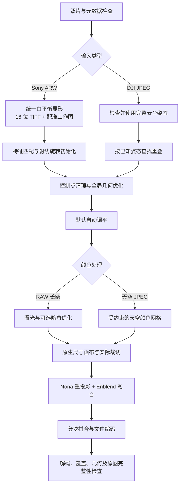

# Pano_Stitch

基于 **Hugin + Python** 的全景拼接实验与可复现工作流，包含普通相机 RAW 长条全景，以及带姿态先验的 DJI 球面全景。

重点解决：照片配准、变焦镜头分组、天空色差、曝光与暗角差异、自动调平，以及十亿像素级结果的分块导出。当前已经在 Sony A7R V 的 38 张 ARW 和 DJI 的 137 张 JPEG 上实测。

## 文档入口

| 文档 | 内容 |
|---|---|
| [算法原理](docs/ALGORITHM.zh-CN.md) | 几何模型、特征匹配、相机射线、全局优化、颜色校正、调平、分块融合与导出 |
| [完整操作步骤](docs/WORKFLOW.zh-CN.md) | 安装、从 RAW 开始的逐步命令、DJI 流程、参数选择、续算及检查 |
| [索尼日光岩案例](docs/SONY_CASE.zh-CN.md) | 本次 38 张照片的处理参数、失败原因、改进结果与输出规格 |
| [验证与常见问题](docs/VALIDATION.zh-CN.md) | 如何读报告、判断拼接质量、诊断断图/色差/导出失败 |
| [依赖与运行环境](docs/DEPENDENCIES.md) | 外部程序、Python 库、已测版本和来源 |
| [实验过程记录](Hugin_test/README.md) | 早期迭代与历史结果；当前操作请以上述手册为准 |

## 支持范围

| 输入与目标 | 使用流程 | 当前边界 |
|---|---|---|
| Sony ARW，近似原地旋转，水平一圈 | RAW 显影 → 普通相机配准 → 圆柱长条导出 | 困难重叠补点和输出投影仍需明确选择 |
| DJI JPEG，完整云台姿态，球面全景 | 姿态先验 → 配准 → 天空色差校正 → 球面导出 | 纯天空可能依赖姿态先验，必须阅读报告 |
| 已完成配准与画布设置的 PTO | `export_flat.py` 按原投影及裁切导出 | 不替用户判断几何模型和投影 |

这是旋转相机全景流程。显著平移、近景视差、绕物体环拍、鱼眼、任意照片的三维重建和生成式补洞不在当前实现范围内。

**水平 360° 不等于 360×180° 球面。** 本次索尼案例只覆盖一圈窄幅视野，输出为圆柱长条，不强行补成 2:1 球体。`stitch.py` 默认渲染分支和 `export_jpg.py` 仍面向球面；普通相机流程应先停在几何阶段，再走圆柱项目准备与 `export_flat.py`。

## 流程总览



## 安装与首次检查

已测环境为 Windows x64、Python 3.12。安装 [Hugin](https://hugin.sourceforge.io/download/) 并准备包含 `pto_gen`、`cpfind`、`cpclean`、`autooptimiser`、`vig_optimize`、`pano_modify`、`pano_trafo`、`nona`、`enblend`、`exiftool` 和 `hugin_executor` 的工具目录。

在仓库根目录的 PowerShell 中执行：

```powershell
py -3.12 -m venv .venv
$Python = (Resolve-Path '.venv\Scripts\python.exe').Path
& $Python -m pip install -r requirements.txt

# 改成实际安装目录；这里只修改当前 PowerShell 会话
$env:HUGIN_BIN = 'C:\Program Files\Hugin\bin'

& $Python -m unittest discover -s Hugin_test\tests -q
& $Python Hugin_test\prepare_raw.py --help
& $Python Hugin_test\stitch.py --help
```

首次上传前，本机 31 项单元测试通过；原生 Hugin 集成与全尺寸导出的实测证据见案例文档。单元测试不代替对用户照片的预览和原尺寸检查。

从 RAW 到成品的命令较多，请按 [完整操作步骤](docs/WORKFLOW.zh-CN.md) 顺序执行。输入照片不随仓库提供，必须指定自己的输入路径。原有 PowerShell 启动器支持 `-PythonExe`；在独立安装环境中请显式传入虚拟环境 Python，不依赖开发机路径。

## 本次索尼案例结果

| 项目 | 结果 |
|---|---|
| 输入 | 38 张 Sony A7R V ARW，119 / 126 / 129 mm |
| 原尺寸显影图 | 9564 × 6376，16 位 sRGB TIFF |
| 全景投影 | 水平 360° 圆柱长条，裁掉不齐边缘 |
| 原生输出 | **216065 × 4602，994331130 像素** |
| 连续母版 | 16 位 BigTIFF，约 4.72 GB |
| 全像素 JPG | 从左到右四段，质量 97、4:4:4 |
| 单张完整便览 JPG | 65000 × 1384，约 33.17 MB，明确为缩小版 |
| 原图完整性 | 38 张 ARW 的 SHA256 与处理前一致 |

单张 JPEG 有尺寸上限。本实现使用的 libjpeg 上限为 65500 像素，长条导出器在超限时保留连续母版和原像素分段 JPG，再生成缩小便览版。全像素表示保留所选原生画布的像素密度，不等于无损压缩或每个方向均有同样的有效细节。

## 仓库内容

仓库跟踪代码、测试、依赖声明、文档及去除本机路径的数值案例。原始照片、显影 TIFF、成品、PTO 运行工程、日志、缓存和第三方二进制工具均由 `.gitignore` 排除，保存在使用者本机。

第三方库与工具各自遵循其项目许可，来源见 [依赖说明](docs/DEPENDENCIES.md)。本仓库目前未指定额外的开源许可证。
